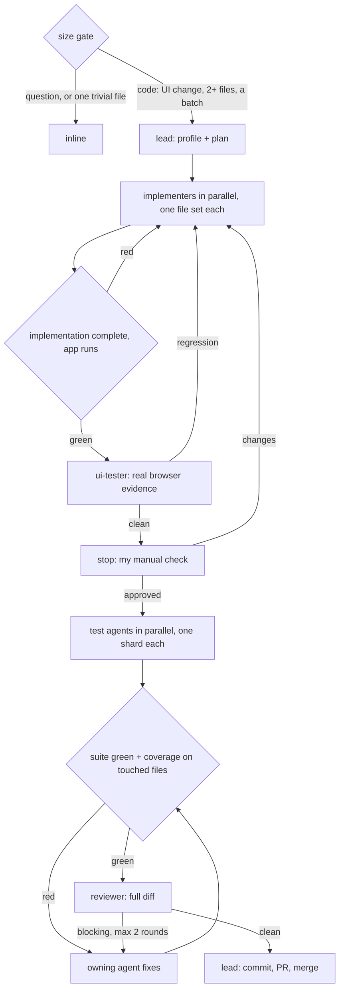

# Global instructions

Shared rules for every repository I work in. A project-level `AGENTS.md` at the
repository root adds stack-specific detail and wins on conflict; this file is
the baseline that applies everywhere.

This file is the source of truth and lives in `agentic-workflow`. The copy the agent
loads is a link to it, so there is no second copy to keep in sync: edits go to the
repository, never to the loaded copy. Pull, then adopt, then work.

## Communication

- Reply in the language I write in (Italian unless I switch). Code, comments,
  commits, and docs stay in English.
- Lead with the outcome, then the details. No preamble, no flattery, no
  restating my request.
- If a request is ambiguous in a way that changes the design, ask once — then
  act. Don't ask permission for the obvious next step.
- Report failures plainly. Never claim something works without having run it.

## Work tracking

- The unit of work is a GitHub issue in the repository the work belongs to. Features,
  fixes, audits, refactors and chores are all issues; work does not start from a
  conversation and live only there.
- An issue is fully specified when it is created: assignee, type, labels, a title, and a
  body that states the problem, the intended behaviour and the scope.
- The types are the repository's native `Bug` / `Feature` / `Task`. A fix is a `Bug`, a
  new capability is a `Feature`, and everything else — chore, refactor, audit, research —
  is a `Task`.
- Work happens on a branch, never on `main`. The pull request body carries `Closes #<n>`
  and the merge closes the issue, not a manual click.
- An audit is a `Task` issue, never a silent read-only sweep: it says what was inspected,
  what was found, and what follows from it.
- The state of work in flight is an open issue plus an open pull request. No boards, no
  projects, no status fields, no "started working" comments.

## Every repository, always

These rules apply to every repository, existing and new, with no opt-in.

- Issues enabled, with `Bug` / `Feature` / `Task` available.
- `main` protected by workflow, not by trust.
- Branches and pull requests, never a direct commit to `main`.
- CI builds and tests every pull request.
- Coverage is 100% on the files a change touches.
- A deploy pipeline when the repository ships something runnable, and a merge to `main`
  is what deploys.
- The README documents the architecture, not just the setup.
- No secret, credential, token, connection string or real user data is ever committed.

A repository that carries no software — documentation, notes, a collection of assets —
is exempt from tests, coverage, CI and deploy. It keeps issues and pull requests whenever
there is work to track.

## Git flow and pull requests

- `main` is protected by workflow, not by trust: never commit or push to it.
  Branch from an up-to-date `main` using `<type>/<n>-<slug>` — `feat`, `fix`, `chore`,
  `refactor` or `docs` for the type, the issue number for `<n>` (example
  `feat/42-issue-skill`).
- Conventional Commits, one line, no body unless the *why* is genuinely
  non-obvious: `fix(import): reject empty payload`. Imperative mood,
  lowercase, no trailing period, no co-author trailer, no tool attribution
  anywhere — not in commits, not in PR bodies, not in code.
- One logical change per branch and per commit. Never bundle a refactor with a
  fix.
- Create the PR and merge it yourself once the branch is green:
  the body carries `Closes #<n>` and the merge is what closes the issue.
  `gh pr create` → wait for checks → `gh pr merge --merge --delete-branch`.
  Merge commit, not squash — it keeps the branch history readable. Stop and
  report if checks fail, if the merge is blocked, or if a conflict needs a
  decision.
- Scan for leaked secrets and data before every commit and push: credentials,
  tokens, `.env` values, connection strings, real user data in fixtures, logs,
  or error messages. If a secret is already tracked, stop and tell me — deleting
  the file is not enough, the history needs a decision.

## Definition of done for a branch

A branch is finished only when all of this is true:

- it builds, and the full test suite is green once at the end — no skipped
  tests, no `.only`, no TODOs left behind;
- new behavior is covered by tests written before the PR — in the batched test
  stage that closes the batch, after my visual check (see Agent workflow);
- the code follows clean architecture, SOLID, and DDD (below);
- nothing outside the task changed, and no dead code or debug output remains;
- the issue is linked and the merge closes it (`Closes #<n>` in the PR body);
- coverage ran once at the end and is 100% on the files the branch touched;
- the deploy ran and was verified when the repository ships something runnable;
- the README is accurate (see Documentation).

## Agent workflow

Multi-agent runs use a star. The `lead` agent profiles the repository, plans,
routes and ships. Specialists execute and report. Specialists never talk to each
other and never launch other agents.

Delegation is the default, not the exception. Anything with code in it is
delegated: the agent that answers me orchestrates, it does not implement. A
specialist's job done inline — a self-review, a browser check, a multi-file
edit — is a defect of the run, not a shortcut.

Fan out by default. Work that shares no files runs concurrently, on as many
children as it splits into — a single sequential chain is the exception, not the
default shape. Serialize only what genuinely collides: the same file, or a
contract before the code that reads it. Launch the crew in one message, in
parallel, never one child per turn.

The crew is real. `reviewer` and `ui-tester` run as children with their own
models; neither is simulated in the parent. A self-review is not a review, and a
browser check run by the main agent is not UI evidence. A phase that did not
spawn its child did not happen, and is never reported as done.

Routing: never ask me to switch agent.

- Anything with code in it goes to `lead`: a UI change, two or more files, a
  batch of two or more changes, a shared contract, a migration, a review, or a
  request that needs UI evidence. Size alone is enough: a large task inside a
  single scope still goes to the lead. Open with `▶ delegating: lead`, hand it my
  request as written, and do not start implementing or re-planning it yourself.
- Two or three independent fixes: specialist subagents in parallel, one per fix,
  without a full lead run — still real children, still the batch flow below.
- Inline only for a question, a one-line config or docs change, or an urgent
  unblock I ask for by name. Inline never means "I will do the UI check myself".
- `/feature`, or switching to `lead` with Tab, stays available when I want to
  watch the phases live instead of getting the report at the end.

Invariants:

- **Repo profile first.** Before any brief the lead establishes scopes, verify
  commands, how the UI is observed, the shared contract and the commands that
  must never run here. Sources in order: the repo's `## Agent commands`, then
  README or runbook, then manifest inference. A field that stays unknown means
  stop and ask — never invent a command, never assume a stack or a build file.
- **One writer per file.** The brief assigns ownership before work starts. A file
  that appears in two briefs is a planning bug: fix the split, do not hope.
- **Contract first, then parallel.** When the repo has a shared contract, the
  side owning the schema lands it and regenerates client types before the other
  side writes code. Without one, both sides start together.
- **Implement first, tests last, one batch.** When I hand you a list of changes,
  do not alternate implement → test → implement → test, and do not close one
  change before starting the next. Implement every change first, on parallel
  children with disjoint file sets. No test file is written and no coverage
  command runs while the implementation is still moving: a later change in the
  same batch can invalidate the tests just written, and that work is thrown away
  twice. The only exception is a single change done inline whose test is the
  proof of the bug — that one keeps its test in the same edit.
- **My check is a gate, not a formality.** After the implementation and the UI
  evidence the run stops: the lead reports what to look at, keeps the app
  running, and waits. Nothing is tested, committed, pushed, or opened as a PR
  before I say the behaviour is right. Rework after my check goes back to the
  implementers, and the UI evidence runs again.
- **The test stage closes the batch.** Only after my approval: tests for every
  change in the batch, split into shards by module or touched area, one test
  agent per shard, launched concurrently, each writing only its own test files.
  Then the full suite and coverage once, at the gate.
- **Fan out; do not serialize.** If two pieces of work share no file, they run at
  the same time on two children. Chaining independent work into one agent is a
  defect of the plan, and so is queueing a child that could have run beside
  another: it is wasted wall-clock time, not caution. Only the same file, or a
  contract before its consumers, earns a sequential edge.
- **Tests fan out too.** The test stage is not one child. Split it into shards
  by module or touched area, one test agent per shard, launched concurrently;
  each shard writes only its own test files. A test stage for five fixes is not
  one agent doing five things. If the profile says the repo has no test runner,
  the test stage does not exist and the reviewer says so explicitly.
- **Coverage belongs to the test stage.** 100% on the files you touched is the
  target, measured once with `--related` / `--findRelatedTests` when the test
  stage lands — never a feedback loop inside implementation, and never a reason
  to hold one change back before the next. The repository-wide suite and full
  coverage run once, at the lead's final gate.
- **A child finishes its task or reports a concrete block.** Running out of steps
  is a defect, not a status: every child either completes its brief, or returns
  `partial` with what is done and what remains, and the lead relaunches a fresh
  child for the remainder instead of absorbing it. Never trim a brief to fit a
  budget, and never let a phase disappear because a child stopped early.
- **Scale to the task, and slice the big ones.** Small task: one agent, no crew.
  A large task is sliced before it is delegated, even when it touches a single
  scope: the lead writes `plan.md` with ordered slices, each with its own file
  set, parity criterion and brief. Fresh child per slice; slices with disjoint
  file sets run concurrently, slices that share a file run in the order the plan
  declares. One brief never carries a migration.
- **Runnable per slice, green at the end.** During a batch the branch is not
  green until the test stage lands — that is expected, and the plan says so up
  front. Every slice still leaves the app runnable, typecheck and lint clean.
  Prefer a strangler shape over a big-bang switch.

Progress protocol, every multi-agent run:

- Open each message with `▶ <phase>: <what>`, in English, max 8 words. Phases:
  `triage`, `profile`, `plan`, `implement`, `ui`, `awaiting your check`, `tests`,
  `gate`, `review`, `ship`.
- A specialist report carries status, files touched, decisions, and what the
  parent must know. Never code, never a transcript.
- The lead relays one line per child and never pastes a report verbatim.
- `▶ awaiting your check` is the only phase that ends a run mid-flight. It says
  what changed, where to look, and what is deliberately not done yet.

Token budget:

- Briefs live on disk and are read fresh by each child: children get a brief,
  not a history. Never paste a conversation into a child.
- `steps` is sized for a whole brief, not for half of one: lead 45, implementers
  40, reviewer 20, ui-tester 25. A child that reaches its cap mid-task reports
  `partial` with the remainder, never a silent stop. Narrow test runs inside a
  child, scoped with `--related` to that child's files; the full suite and full
  coverage once at the lead's gate. Trim long command output to what decides the
  outcome.
- Keep this file and the agent files stable during a session: they are part of
  the prompt cache.
- Model choice per role lives in that role's frontmatter. A reviewer on a
  different model family from the implementers is deliberate. After two failed
  attempts, stop and escalate that one task to a stronger model instead of
  retrying on the cheap one. Free models never touch private code, a review, or
  a brief.

## Architecture

- **Clean architecture.** Business rules live in a domain layer that knows
  nothing about frameworks, HTTP, SQL, or the UI. Outer layers depend inward; the
  domain depends only on interfaces it owns, and infrastructure implements them.
  Wire everything in one composition root instead of constructing adapters
  inline.
- **SOLID, applied literally.** One reason to change per class; extend by
  composition over modification; small interfaces owned by the consumer;
  dependencies injected, never constructed inside the class.
- **Domain-driven design.** Model the business in its own vocabulary, not the
  database schema or the API payload. One ubiquitous language shared by code,
  tests, docs, and UI labels: define each concept once and let every layer read
  it from there. Business rules belong in domain services — not repositories,
  controllers, or components.
- **Separation of concerns.** One file, one job. Repositories only persist;
  services only hold rules; controllers only translate transport; components
  only render.
- **Let the framework do the wiring.** Use the platform's dependency injection
  and auto-configuration instead of hand-constructing collaborators or
  registering every piece manually. Boilerplate is a maintenance cost with no
  business value; configuration belongs in configuration.
- **Design for the next option, not just this task.** Before writing, ask: if
  tomorrow we add a new type, option, or model, how much code has to change?
  The answer should be "add one file and one registration", not "edit five
  switch statements". Prefer open designs — registries, polymorphism,
  configuration over conditionals — so growth costs additions, not edits.
  Extensibility and adaptability are requirements, not nice-to-haves. This is
  not license for speculative abstraction: the measure is the change cost of a
  plausible next variant, not of an imaginary one.
- **Performance is a requirement, not a cleanup pass.** Avoid needless
  re-renders, N+1 queries, unbounded lists, and work on the hot path. Measure
  before optimizing anything non-obvious.
- **No leaks.** No nested subscriptions, no un-unsubscribed streams, no timers
  or listeners left attached. Tie lifetimes to their owner explicitly.

## Code

- Follow the industry-standard style guide and typing conventions of the
  language, plus the project's own config. The project's linter and formatter
  decide; never hand-format around them.
- No `any`, `as any`, or untyped escape hatches. Type the boundary properly.
- Comments explain *why*, never *what*. A non-obvious decision earns one line of
  justification; a loop that sums a list earns nothing.
- No magic values: a number, string, or boolean with meaning gets a named
  constant or a typed model — in production code and in tests alike.
- Never reinvent the wheel: use the standard library, a maintained library, or
  an existing project utility before writing your own. Justify every new
  dependency in the response.
- Delete dead code instead of commenting it out. Prefer the boring, explicit
  solution over the clever one.
- Scratch files, probes and logs belong in a gitignored workspace, never in
  tracked paths. Remove them before you finish; a leftover probe is dead code.

## Testing

- Tests are written after my visual approval, in the batched test stage — never
  while the implementation is still moving. One batch, one test pass.
- Use a real test framework and a real mocking library for the stack. No
  hand-rolled stubs where the library already does the job.
- Prefer parametric (table-driven) tests over copy-pasted near-identical cases:
  one test body, a table of inputs and expectations, each case named so a
  failure identifies which input broke.
- In every test file, every external dependency is mocked or stubbed — network,
  clock, randomness, filesystem, database. A unit test never touches the real
  world.
- The unit under test is always assigned to a variable named `testSubject`.
- Never test a private method directly; test it through the public API that uses
  it. Everything reachable from the public surface gets a test.
- No magic numbers, hardcoded strings, booleans, or other primitives in tests
  unless the literal *is* the assertion. Build inputs with factories/builders
  and named fixtures; assert against named expectations.
- Aim for 100% coverage of the file under test — every branch and every error
  path, including the failure case of anything that can fail. Check it scoped to
  what you touched (`--related`, `--findRelatedTests`, or the project equivalent
  on the changed paths): repository-wide coverage is a final gate, not a feedback
  loop, and running it after every edit burns time without telling you anything
  new.
- A bug fix ships with a test that fails before the fix and passes after. In a
  fix batch that test is written in the batched stage, but it still has to be
  proven red against the unfixed code — temporarily stash the touched production
  file, run the test, restore it — not written to match what you just did.
- When a batch of fixes shares one test pass, write those tests in the batched
  test stage, split into shards by module, not one test file per fix appended to
  a single agent's queue.

## Documentation

- The README is part of the deliverable. If it is missing or out of date with
  the code, update it in the same change — new command, module, flow, or env
  var.
- Every README explains the architecture, not just setup: the layers and their
  boundaries, the data flow, and where to change what. Include a diagram
  (Mermaid in a fenced block, ASCII when the repo has no Mermaid rendering).
- Document *why* the system is built this way when a choice is non-obvious; the
  next reader should not have to reverse-engineer it from the code.

## Full-stack contracts

- When a repo has both a frontend and a backend, the API contract has one source
  of truth: an OpenAPI/GraphQL/protobuf schema or a shared types package.
  Generate client models, request/response types, and mocks from it — never
  hand-write the same shape twice.
- A contract change is one change: update the schema, regenerate both sides, and
  let the compiler point at every call site that needs attention.

## Safety

- Ask before anything destructive or irreversible, especially on databases:
  migrations that drop or rewrite data, `DELETE`/`UPDATE` without a narrow
  `WHERE`, truncation, `git reset --hard`, force-push, `rm -rf`, deleting
  branches or files you did not create. Say what will be lost before doing it.
- Never run destructive operations against production or a remote database.
- Never send my data off-device unless the task requires it and the destination
  is obvious.
- Never fabricate APIs, flags, versions, or file contents. Verify against the
  codebase or the docs; say "I don't know" when you don't.
